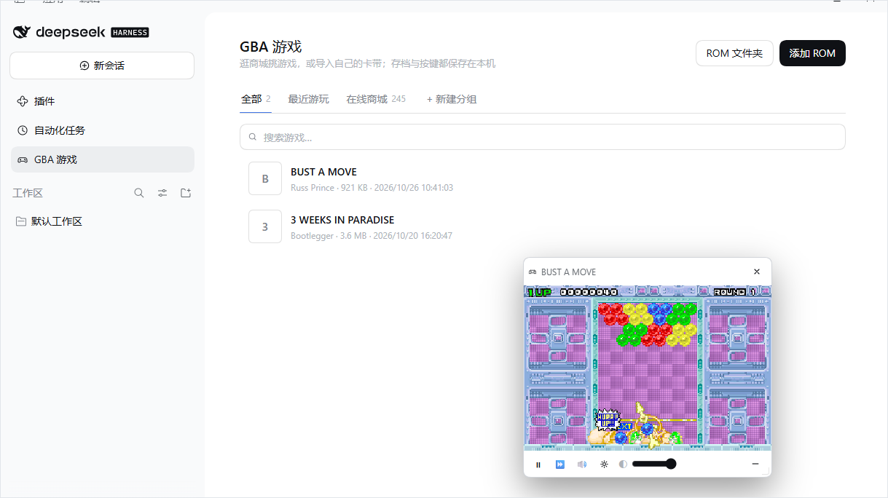
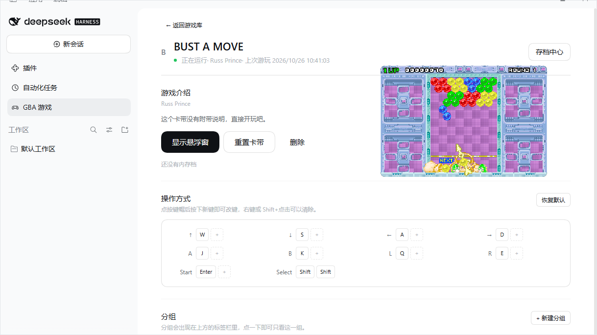
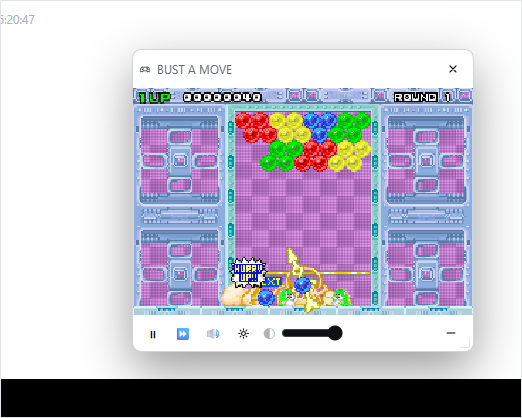

# dsh-gba

**Play Game Boy Advance inside DeepSeek Harness.**

A Harness bundle that puts a GBA emulator in the main column — an online store of 245 free
community games, your own cartridges, battery saves and save states — with the picture in a
floating window that stays on screen while you keep working.

English · [简体中文](README.zh.md)



## Why this exists

Retro emulators usually live in their own tab, which means leaving whatever you were doing.
This one lives *inside* the Harness: the panel is where you browse and configure, and the game
itself sits in a small always-available window above every column. `Ctrl+Q` hides it in one
keystroke, and `Ctrl+Q` brings it back with the game still running.

It also takes the boring parts seriously: saves live on the Host rather than in
`localStorage`, key bindings are rebindable and persist, and a cartridge keeps its save when
you switch browsers.

## Features

- **An online store of 245 games.** The Store tab reads the
  [Homebrew Hub](https://github.com/gbadev-org/games) community database: jam winners, full
  RPGs, puzzlers, tech demos — each with its cover, developer, date, genre and description.
  *Download and play* fetches the cartridge once, caches it, and starts it.
- **Your own cartridges.** Add a `.gba` file directly, or point the plugin at folders on the
  Host and import from the list. Cartridges are identified by CRC32 against the no-intro
  census, so a real dump shows its proper title and box art.
- **Groups.** Make your own tabs ("RPG", "Co-op", whatever) and tag games into them.
- **A floating player.** Drag it by the screen or the title bar, resize from the corner,
  adjust its opacity; its chrome only appears while the pointer is over it.
- **Rebindable controls.** `WASD` to move and `J`/`K` to act by default; click a key cap and
  press the new key. Two keys per button, and the map follows you between browsers.
- **Saves that survive.** Battery saves (`.sav`), five save-state slots and a rolling
  auto-snapshot, all under `$DSH_HOME`, so a reload, a restart or another session sees them.
- **Looks like the Harness.** Built from the theme's own tokens and the Dialog/Button
  primitives — no hard-coded colours, no separate design language.

| A game's page | The floating window |
| --- | --- |
|  |  |

*The game keeps running in a window above every column; its chrome only appears on hover.*

## Install

This is a **persistent Harness bundle**: it installs into a profile, survives restarts, and is
available in every session of that profile.

### From a plugin market

If a market index lists `dsh-gba`, open **Plugins → Discover**, add the index URL, and install
it there.

### From a folder

1. Unpack the bundle somewhere permanent.
2. **Plugins → Add**, and give it that folder — or ask the assistant in a session:

   > Install this directory as a bundle: `D:\path\to\dsh-gba`

3. A **GBA games** entry appears in the left sidebar beside Plugins and Scheduled tasks.
   Reload the page if it does not.

### Requirements

| Item | Value |
| --- | --- |
| Harness | 0.2.x, any profile with the Web GUI |
| Disk | ~3 MB |
| Network | only for the store and box art, and only on first use |
| Build step | none — no `npm install`, no compiler |

## Using it

1. Open **GBA games** in the left sidebar.
2. Switch to **Store**, pick a game, press **Download and play**.
3. The game runs in the window at the bottom right. Hover it for the toolbar.

The **All** tab lists everything you own. Click a row for its page: the description, the big
Play button, the control map and its groups.

### Keyboard

| Key | GBA button |
| --- | --- |
| `W` `A` `S` `D` | D-pad |
| `K` | A |
| `J` | B |
| `U` | L |
| `I` | R |
| `Enter` | Start |
| `Shift` | Select |
| `Ctrl+Alt+G` | show / hide the floating window |
| `Ctrl+Q` | boss key: hide, then restore |

Click the screen first: the emulator only takes keys while the screen holds focus, so the
composer keeps working normally. Everything except the last two is rebindable, from a game's
page or from the window's gear panel.

`Ctrl+Q` cannot live in the Harness shortcut service — it reserves that chord — so the plugin
listens for it directly. `Ctrl+Alt+G` is registered there and can be changed in the Harness
shortcut settings.

## Where your data lives

Everything durable is under `$DSH_HOME/storages/dsh-gba/` (`~/.dsh` by default), never in the
package:

```
$DSH_HOME/storages/dsh-gba/
├── settings.json            volume, fast-forward, ROM folders, key bindings,
│                            groups, window opacity
├── covers/<slug>.png        box art cached from the public libretro mirror
├── store/                   store covers and downloaded cartridges, cached
├── games/                   drop folder used when no ROM folder is configured
└── roms/<id>/
    ├── rom.gba              the cartridge as imported
    ├── rom.json             name, title, CRC32, game code, source
    ├── save.sav             battery save (SRAM / Flash)
    └── states/
        ├── 0.ss … 4.ss      the five manual slots
        └── 9.ss             the rolling auto snapshot
```

Disabling the bundle leaves this directory alone, so re-enabling it brings your library and
saves back. Delete it by hand to start over.

## How it works

| Half | File | Responsibility |
| --- | --- | --- |
| Host | `index.js` | Serves the mGBA assets, the store index and box art; downloads store cartridges on demand; walks ROM folders; owns the `/dsh-gba/api` library, ROM, save, state and settings routes. |
| Client | `client.js` | Registers the `gba-games` main panel, its sidebar entry, the `shell.overlay` floating window and the shortcuts; owns the single mGBA instance and its canvas. |

One emulator runs per browser tab and the floating window is its only screen, so there is
nothing to re-sync after a resize, a reload or a boss-key hide: the engine keeps one `<canvas>`
and moves it between holders by priority.

Every Host route passes the same Connection trust fence and browser cookie as the rest of the
Web GUI, so a cross-site page cannot read the library (`403` for a foreign `Origin`, `401`
without the session cookie). Store downloads only ever fetch the paths listed in `store.json` —
a caller cannot name an arbitrary URL — and only files inside a configured ROM folder can be
imported.

### Why the core is pinned to mGBA 1.1.1

The 2.x builds of the WebAssembly port are multi-threaded and need `SharedArrayBuffer`, which a
browser only grants to a cross-origin-isolated page (`COOP: same-origin` + `COEP: require-corp`).
The Harness Web server does not send those headers and a plugin cannot add them to the index
response. 1.1.1 (mGBA 0.11 core) is the last single-threaded build and runs on an ordinary
origin, which is what makes an embedded window possible at all.

## About ROMs

**This bundle ships no ROM data.** `store.json` is an index of where cartridges live upstream;
`catalog.json` is a no-intro metadata table used only to recognise a cartridge you already have.
A `.gba` reaches disk only when you install one.

Adding your own files is your responsibility: dumping a cartridge you own is legal in most
jurisdictions, downloading one you do not own is not.

## Development

```bash
node test-host.mjs     # mounts the Host half on a stub Cordis context and asserts every route
```

The test covers the empty library, the assets, the store index, ROM import and CRC recognition,
battery saves, save states, play time, settings (window state, opacity, key bindings, groups), a
folder scan that ignores non-cartridges, import by scanned path, the path guard, the size
guards, deletion, and the auth fence. It needs no network and leaves nothing behind.

The panel was checked in a React 18 harness as well: the tabs, the rows, the game page blocks,
the control grid, the dialogs and the floating window are all exercised by DOM assertions.

## Credits

- [mGBA](https://mgba.io/) by endrift and contributors — MPL-2.0
- [Homebrew Hub](https://github.com/gbadev-org/games) — the community game database behind the store
- [libretro-database](https://github.com/libretro/libretro-database) — the no-intro DAT the
  catalogue derives from
- [thumbnails.libretro.com](https://thumbnails.libretro.com/) — box art

See [`THIRD_PARTY_NOTICES.md`](THIRD_PARTY_NOTICES.md) for the details.

## License

[MIT](LICENSE) for this plugin's own code. The emulator core and the third-party data keep
their own licenses.
